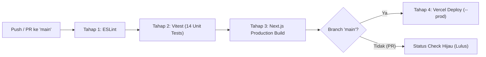

# Panduan Production Deployment & CI/CD PanduIn

Dokumen ini memandu langkah demi langkah konfigurasi pipeline **CI/CD (GitHub Actions)**, deployment ke **Vercel**, basis data **Supabase**, dan **Gemini API**.

---

## 1. Arsitektur CI/CD Pipeline

Pipeline otomatis didefinisikan pada [.github/workflows/ci-cd.yml](file:///d:/Projects/fomo-panduin-seventx/.github/workflows/ci-cd.yml):



---

## 2. Variabel Lingkungan (*Environment Variables*)

Aplikasi PanduIn membutuhkan 4 variabel lingkungan utama:

| Nama Variabel | Lokasi Digunakan | Deskripsi |
| :--- | :--- | :--- |
| `NEXT_PUBLIC_SUPABASE_URL` | Client & Server | URL Project Supabase (contoh: `https://vmailnuloaoonmqeguok.supabase.co`) |
| `NEXT_PUBLIC_SUPABASE_ANON_KEY` | Client & Server | Public Anon Key Supabase untuk query client RLS |
| `SUPABASE_SERVICE_ROLE_KEY` | Server Only | Secret Service Role Key untuk operasi backend aman |
| `GEMINI_API_KEY` | Server Only | Google Gemini API Key (model `gemini-3.8-flash`) |

---

## 3. Langkah Konfigurasi GitHub Secrets

Untuk mengaktifkan deployment otomatis via GitHub Actions:

1. Buka repositori proyek di GitHub.
2. Navigasi ke menu **Settings** > **Secrets and variables** > **Actions**.
3. Klik tombol **New repository secret** dan masukkan daftar rahasia berikut:

### Kredensial Vercel:
* **`VERCEL_TOKEN`**: Buat token di [Vercel Account Settings > Tokens](https://vercel.com/account/tokens).
* **`VERCEL_ORG_ID`**: Didapatkan dari file `.vercel/project.json` setelah menjalankan `npx vercel link` (atau dari Settings Tim Vercel).
* **`VERCEL_PROJECT_ID`**: ID proyek Vercel Anda (didapatkan dari file `.vercel/project.json` atau URL Project Settings Vercel).

### Kredensial Supabase & Gemini (Untuk Build & Test Runner):
* **`NEXT_PUBLIC_SUPABASE_URL`**: URL instance Supabase Anda.
* **`NEXT_PUBLIC_SUPABASE_ANON_KEY`**: Anon key dari Dashboard Supabase > Project Settings > API.
* **`SUPABASE_SERVICE_ROLE_KEY`**: Service role secret key Supabase.
* **`GEMINI_API_KEY`**: API Key dari Google AI Studio.

---

## 4. Konfigurasi di Dashboard Vercel

Selain pada GitHub Actions, variabel lingkungan wajib dimasukkan pada Dashboard Vercel:

1. Buka [Vercel Dashboard](https://vercel.com/) dan pilih project **fomo-panduin-seventx**.
2. Masuk ke tab **Settings** > **Environment Variables**.
3. Tambahkan 4 variabel:
   * `NEXT_PUBLIC_SUPABASE_URL` (Pilih: Production, Preview, Development)
   * `NEXT_PUBLIC_SUPABASE_ANON_KEY` (Pilih: Production, Preview, Development)
   * `SUPABASE_SERVICE_ROLE_KEY` (Pilih: Production, Preview, Development)
   * `GEMINI_API_KEY` (Pilih: Production, Preview, Development)
4. Klik **Save**.

---

## 5. Menjalankan Unit Test Secara Lokal

Untuk memverifikasi fungsionalitas sebelum melakukan push ke GitHub:

```bash
# Menjalankan seluruh pengujian unit sekali jalan
npm run test

# Menjalankan pengujian dalam mode interaktif (watch mode)
npm run test:watch
```

Cakupan unit test yang diverifikasi:
* **`modules-store.test.ts`**: Validasi kode kelas 6 digit, CRUD modul, sinkronisasi Supabase & LocalStorage, serta pencatatan progres latihan siswa.
* **`gemini.test.ts`**: Fallback aman kartu peraga SLB dan konversi instruksi Smart TV multi-kata (2–3 kata).
* **`SignBox.test.tsx`**: Render isyarat tangan anatomis SIBI & BISINDO, target sentuh aksesibilitas, dan status aktif.
* **`supabase.test.ts`**: Inisialisasi koneksi basis data Supabase (browser & server client).

